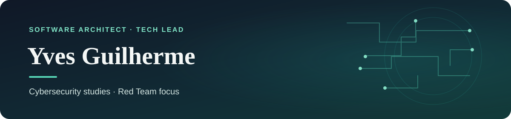
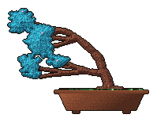

  

  
  
  

## About

I’m 31, based in Brazil, and have worked in technology since 2016. I currently work as a Software Architect and Tech Lead. I’m studying cybersecurity through a training program, with the goal of becoming a penetration tester focused on Red Team operations.

## Development toolkit

<strong>Languages & frameworks</strong> 
  

<strong>Web & UI</strong> 
  
  

<strong>Cloud & infrastructure</strong> 
  
  

<strong>Operating systems & security</strong> 
  
  

<strong>IoT & messaging</strong> 
  
  

<strong>Tools</strong> 
  

<strong>LLM agents, harnesses & MCP</strong> 
  
  
  
  
  
  
  
  

LLM harness tooling · model routing · MCP servers

## Git Bonsai & pixel coding

  
  &nbsp;&nbsp;
  

A Git Bonsai grown from my public history, with a tiny retro coding loop.

